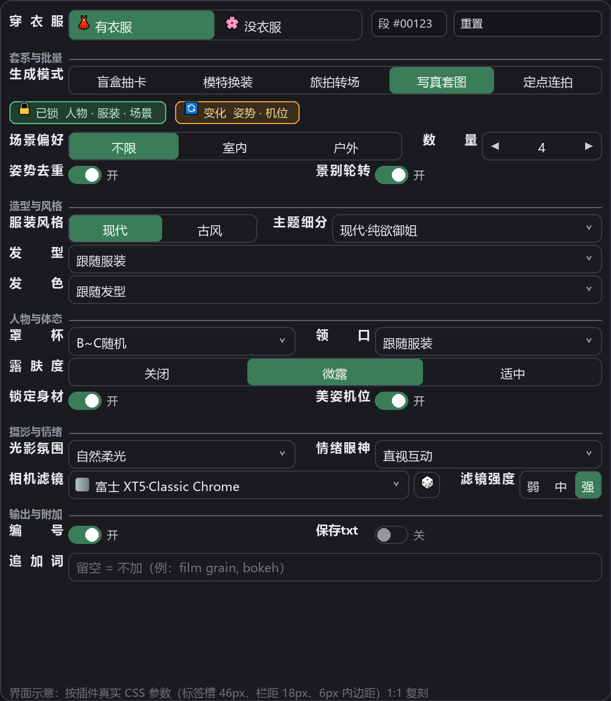
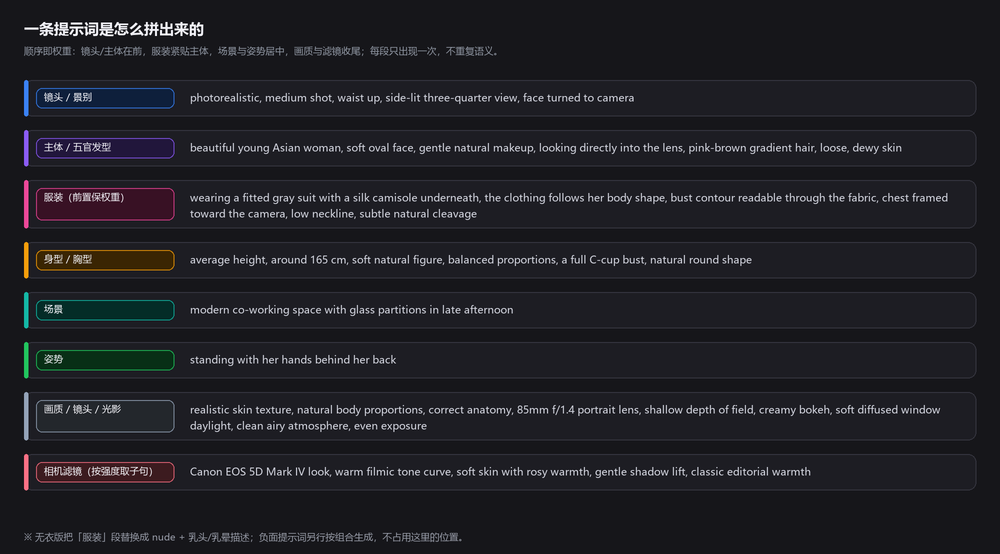
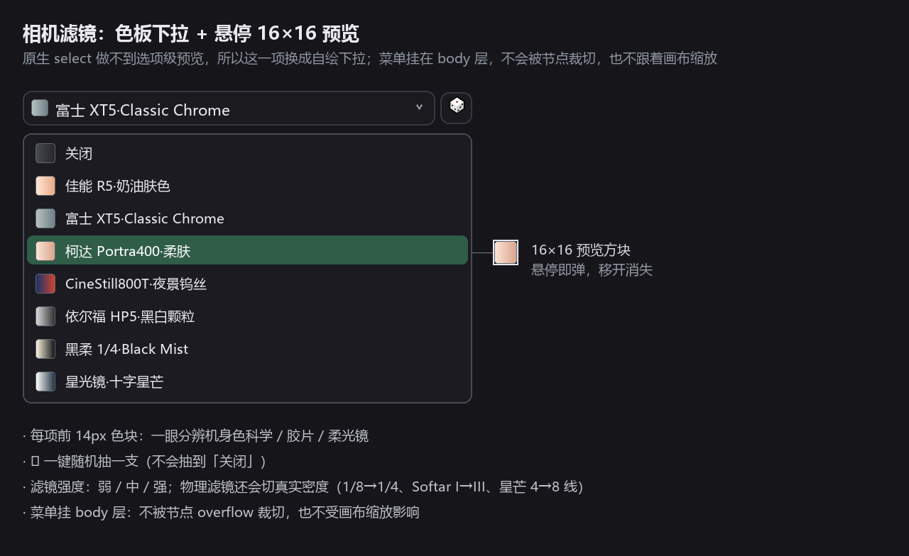

# ComfyUI-Crazy3DS-PromptMaster

**Crazy3DS 美女提示词大师** · 商业人像级提示词批量生成节点（ComfyUI Custom Node）


> 它不拼随机词。它把**摄影师的工作流**写进提示词：先决定「这一批锁什么、变什么」，再决定「谁、穿什么、在哪、怎么拍」。



> ⚠️ **内容提示**：本节点含成人向（NSFW）词库与无衣模式，仅限 18 岁以上用户自行负责使用；建议仓库以 Private 方式托管。

---

## 一、它到底在解决什么问题

普通提示词节点的输出是「一次性拼盘」：每条都随机，看着热闹，但**没法成组使用**——同一个模特的脸变了、衣服变了、场景也变了，出十张图像十个不同项目。

这个节点按**摄影企划**的方式组织：先锁住不该变的东西（人 / 衣 / 景 / 机位），只放开该变的东西（姿势、景别、滤镜）。于是你能一次拿到：

- 一套**同一个人、同一套衣服、同一个场景**的写真（换姿势换机位）
- 一套**同一个人、同一套衣服、不同场景**的旅拍分镜
- 一套**同一个人、不同衣服、不同场景**的品牌 lookbook
- 一套**机位完全锁死、只换动作**的动作参考表
- 以及 **有衣 / 无衣同构图对拍**的两版

输出三个口：`提示词`（列表）、`负面提示词`（随组合生成）、`段信息`（每行的模式/段号/场景/姿势/景别/机位）。

---

## 二、好玩之处（为什么值得用）

### 1. 五档套系 = 五种拍摄企划，而不是五个随机种子

| 模式 | 锁什么 | 变什么 | 适合拿来干什么 |
|---|---|---|---|
| 🎲 **盲盒抽卡** | 什么都不锁 | 人 · 衣 · 景 · 姿 · 镜 | 找灵感、测模型风格、抽卡玩 |
| 👗 **模特换装** | 👤人物 | 衣 · 景 · 姿 · 镜 | 一个人跑 N 套衣服 N 个场景 → lookbook、电商选款 |
| 🧳 **旅拍转场** | 👤人物 · 👗服装 | 景 · 姿 · 镜 | 同一套穿搭在 8 个场景里游走 → 旅行故事、连续分镜 |
| 📷 **写真套图** | 👤人 · 👗衣 · 🏞️景 | 姿 · 镜 | 一套真正的「同场景写真」，多机位多动作 |
| 🎬 **定点连拍** | 👤人 · 👗衣 · 🏞️景 · 🎥机位 | 仅 💃姿势 | 视频首尾帧、动作表、同机位 LoRA / 一致性训练集 |

界面顶部会实时显示 **「🔒 已锁 / 🔄 变化」** 两块徽章，一眼看清当前模式在锁什么。

### 2. 有衣 / 无衣「同构图对拍」

顶部「穿衣服」一开一关，**同一种子下场景、姿势、机位完全一致，只换服装**。这带来几个很实用的玩法：

- 服装对成片的影响（before / after）
- 换装类工作流（先出无衣版，再用 ControlNet 上衣服）
- 人体比例 / 体态的一致性检查
- 同构图两版做 AB 测试

### 3. 26 档主题细分 = 26 个拍摄企划

现代 15 档：日常穿搭 / 纯欲御姐 / 通勤OL / 私密居家 / 运动休闲 / 甜酷街头 / 泳装度假 / 晚礼服 / 新中式旗袍 / 校园清纯 / 法式优雅 / 街头机能 / 婚纱白纱 / 度假亚麻 / 暗夜酷感
古风 10 档：华丽宫廷 / 清雅书卷 / 飒爽侠女 / 妩媚风情 / 魏晋宽袖 / 飘逸仙侠 / 婚嫁红妆 / 异域胡旋 / 禅意道袍 / 女扮男装

每一档都带**场景倾向**：旗袍会进茶室画廊大堂、校园会进教室图书馆咖啡馆、机能会进雨夜街头、婚纱会进礼堂露台——不会出现「泳装逛超市」。

### 4. 相机滤镜：24 支机身/胶片/柔光镜 + 强度分档

一次生成**整套统一色调**的图：同一支 Portra 400，或者同一台佳能 R5 的奶油肤色。
弱 / 中 / 强调的是「描述浓度」，物理滤镜还会切真实密度档（Black Mist 1/8→1/4、Softar I→III、星芒 4→8 线）。

### 5. 负面词不是死模板，而是跟着组合走

同一组参数永远得到同一条负面词（可复现），但会按你的选择追加专项排除：
古风 → 禁现代道具；无衣 → 禁布料；黑白 → 禁彩色噪点；夜景 → 禁日光；柔光镜 → 禁过度锐化。

### 6. 穿帮消解（这一版最花功夫的地方）

- 姿势引用的道具必须真实存在于场景：**书店不会出现床，咖啡馆不会出现浴缸/灶台**
- 雪景姿势不会出现在湖畔；石灯笼不会出现在现代街区
- 高领单品不会同时写「胸口敞开」
- 背面机位不会配正面姿势
- 夜景不会硬塞日光、白天不会硬塞霓虹
- 泳装只进水景、婚纱/礼服只进厅堂礼堂、睡裙只进居家

### 7. 细节体验

- 参数标题**两端对齐**，2 字与 4 字标题右边界一致，控件左边界统一
- 「数量」是**左右箭头步进框**，可长按连续加减
- 相机滤镜是**色板下拉**：选项前带色块，悬停弹出 16×16 色彩/特效预览，右侧 🎲 一键随机
- 面板区域可用**中键直接拖动画布**，不需要先点空白处
- 每个参数悬停都有说明，冲突时底部会写明「已按规则自动避让：…」
- 🔁 一键重置、段号实时回显

---

## 三、一条提示词是怎么拼出来的



顺序即权重：镜头/主体在前，服装紧贴主体（防止被长尾稀释），场景与姿势居中，画质/镜头/滤镜收尾。
每一段只出现一次，不重复语义；换装失败、场景串味、机位打架这几类问题都是在这一层解决的。

---

## 四、相机滤镜与强度



| 强度 | 提示词构成 |
|---|---|
| 弱 | `subtle` + 仅核心色彩科学一句（不含颗粒 / 光晕 / 散景 / 对比） |
| 中 | 核心 + 前 2 个特征（多为对比 / 肤色 / 高光） |
| 强 | 核心 + 全部特征（旧版默认行为，默认值） |

```
HP5 弱：subtle Ilford HP5 Plus black and white film look, monochrome
HP5 中：… monochrome, rich tonal range, visible grain
HP5 强：… monochrome, rich tonal range, visible grain, deep blacks, classic documentary contrast
```

24 支滤镜：佳能 R5 / 5D4、尼康 Z8 / D850、索尼 A7RV / A7M4、富士 XT5 / X100VI / GFX100、
徕卡 M11 / SL2、哈苏 X2D、飞思 IQ4、柯达 Portra400 / Gold200 / Ektar100、富士 Pro400H、
CineStill 800T、依尔福 HP5、黑柔 1/4、白柔 Glimmerglass、柔焦 Softar、星光镜。

---

## 五、安装

```bash
cd ComfyUI/custom_nodes
git clone https://github.com/GITHUB_USER/ComfyUI-Crazy3DS-PromptMaster.git
```

或下载 ZIP 解压到 `ComfyUI/custom_nodes/ComfyUI-Crazy3DS-PromptMaster/`，重启 ComfyUI。

- 无第三方依赖（纯标准库）
- 前端是原生 DOM 面板，无需构建
- 若已收录 ComfyUI Manager，也可直接搜索安装

## 六、使用

节点分类：`Crazy3DS/提示词大师` → **Crazy3DS 美女提示词大师 v69**

| 输出 | 类型 | 说明 |
|---|---|---|
| `提示词` | STRING（列表） | 纯净列表，可直接连 CLIP Text Encode |
| `负面提示词` | STRING | 按当前参数组合生成，同参数可复现 |
| `段信息` | STRING | 每行标注 模式/段号/场景/姿势/景别/机位 |

### 参数

| 参数 | 取值 | 说明 |
|---|---|---|
| 随机种子 | 0 ~ 2^64 | 同种子 = 同批结果；段号由种子换算（1~50000 段） |
| 穿衣服 | 有衣服 / 没衣服 | 关掉后自动置灰「领口 / 露肤度」 |
| 场景偏好 | 不限 / 室内 / 户外 | 泳装水景、礼服厅堂也遵守 |
| 数量 | 1–200 | 左右箭头步进，长按连加 |
| 生成模式 | 五档 | 见上表 |
| 姿势去重 | 开 / 关 | 同批姿势不重复 |
| 景别轮转 | 开 / 关 | 全身 / 七分身 / 半身 / 远景 / 中全景轮换 |
| 罩杯 | B~C随机 / B / C / D / 关闭 | 穿衣写「透布轮廓」，无衣写「自然胸型」 |
| 领口 | 跟随服装 / 高领 / 圆领 / 低领 / 深V / 一字肩 | 古风自动映射交领/坦领/诃子 |
| 锁定身材 | 开 / 关 | 整批锚定 160/165/170cm 骨架 |
| 美姿机位 | 开 / 关 | 显比例机位池 + 35/50/85mm 自动匹配 |
| 露肤度 | 关闭 / 微露 / 适中 | 优先于领口；高领会自动退回跟随服装 |
| 服装风格 | 现代 / 古风 | 服装池与场景池物理隔离 |
| 主题细分 | 26 档 | 带场景倾向 |
| 发型 / 发色 | 跟随 / 经典 / 现代 / 古风 等 | 古风装自动配古风发髻 |
| 光影氛围 | 跟随场景 / 自然柔光 / 落日逆光 / 暗调情绪 / 闪光直打 / 霓虹夜景 | 夜景不再发灰，白天不硬塞霓虹 |
| 情绪眼神 | 自然随机 / 直视互动 / 松弛抓拍 / 清冷高级 / 温婉甜美 / 微醺慵懒 | 背身机位会自动改成「回头视线」 |
| 相机滤镜 | 24 支 | 见上 |
| 滤镜强度 | 弱 / 中 / 强 | 见上 |
| 编号 | 开 / 关 | 只影响「段信息」和 txt，不影响提示词列表 |
| 追加词 | 文本 | 拼在每条末尾，例：`film grain, Fujifilm XT4` |
| 保存txt | 开 / 关 | 落盘到 `output/crazy3ds_pair_XXXXX_NN_clothed.txt` |

---

## 七、负面提示词的构成

```
负面提示词 = 统一画质基线（画质 / 解剖 / 防打码 / 防二次元 / 防伪影）
           + 按组合追加（服装风格 / 有衣无衣 / 场景偏好 / 光效 / 滤镜）
```

| 你的选择 | 会追加的排除项 |
|---|---|
| 古风 | `modern objects, sneakers, wristwatch, car, power lines, plastic bag, air conditioner, latin signage` |
| 现代 | `hanfu, ancient chinese costume` |
| 有衣服 | `nude, topless, exposed nipples` |
| 没衣服 | `clothing, underwear, bra straps, fabric folds` |
| 户外 / 室内 | `indoor room, studio backdrop` / `open landscape, wilderness` |
| 霓虹夜景 / 自然柔光 / 落日逆光 / 闪光直打 | 对应反向光效词（闪光 + 柔光镜时不会自我打架） |
| HP5 黑白 | `color, color cast, rainbow halation, oversaturated` |
| 黑柔 / 白柔 / 柔焦 | `over-sharpened, crunchy detail, harsh edges` |

---

## 八、常见问题

**Q：定点连拍为什么景别还在变？**
A：那是「景别轮转」在起作用。想要绝对同机位，把它关掉，景别也会一起锁死。

**Q：为什么换了参数结果全变了？**
A：种子决定段号，段号决定从池子里抽哪一条。主题/场景/滤镜池扩容后，同种子自然会抽到新内容。

**Q：负面词为什么每个组合都不一样？**
A：这是故意的——统一模板对古风、黑白、无衣这些特殊组合没有针对性。同一组参数永远得到同一条负面词，可复现。

**Q：提示词有点长？**
A：约 150 词，每段信息唯一、无重复；想更短可以关掉滤镜或不用追加词。

**Q：画面出现穿帮怎么办？**
A：把「段信息」那一整行发到 Issue，这类反馈最有价值。

---

## 九、目录结构

```
ComfyUI-Crazy3DS-PromptMaster/
├── __init__.py                 # 节点注册 + WEB_DIRECTORY
├── prompt_pair.py              # 词库 / 场景 / 姿势 / 滤镜 / 负面词 / 节点类
├── web/js/pair_prompt_ui.js    # 自定义 DOM 面板
├── docs/                       # 界面示意图（按真实 CSS 参数绘制）
├── pyproject.toml
├── CHANGELOG.md
└── LICENSE
```

## 十、版本历史

见 [CHANGELOG.md](CHANGELOG.md)。当前 **v69**。

- **v69** 相机滤镜强度分档（弱/中/强 + 物理密度档）
- **v68** 组合相关负面词、提示词洁净度修复（重复语义/机位朝向/高领冲突/雪景穿帮）
- **v67** 无衣版乳头与乳晕描述、防打码负向词
- **v66** 主题 26 档、场景道具标签与冲突消解
- **v65** 相机滤镜 24 支、面板重做

## 十一、许可

MIT License —— 见 [LICENSE](LICENSE)。
